# 【避雷实录】点个赞还得过“正宫审查”？一张 Grok 相关同人图，竟扯出死亡诅咒、身份恐吓与“开户哥们”

> **授权与公示**：本文经苦主（X：`@Fallon_4048`）授权整理，记录2026年11月发生的网络骚扰事件，供读者了解经过、辨别风险。截图中的真实姓名、证件照片、验证码及医疗隐私已遮盖，不公开任何人的私人身份资料。
>
> **一枚随手点赞，竟能闹到有人扬言“期待你死掉”“我找人操你”“查出来你在哪个大学你就完蛋了”。** 谁能想到，这场令人瞠目结舌的闹剧，最初只是一张被推荐流推到眼前的 Grok 相关约稿？
>
> 本文依据苦主提供的事件说明、私信及公开帖子整理。**按时间线叙述，17张事件截图穿插展示**。部分行为主体之间的关联仍以当事人陈述为准，但截图中那些恶毒言语本身，白纸黑字摆在那里。

## 一、太长不看：三句话吃明白这个离谱瓜

1. **起因荒诞：** 苦主喜欢 Grok × Claude（gkcl）的同人内容，在 X 推荐流里看到一张 Grok 相关双人约稿，觉得画得不错，随手点赞。结果发帖者跑来私信，称自己早在小红书拉黑过苦主，要求“不要再来打扰”。
2. **强行对号入座：** 苦主客气道歉，后来在自己主页不点名感叹“人机恋有拒同担的吗”。对方却围绕 gkcl、“属性”和“毒唯”争论不休，明明谈到“互相拉黑，以后互不干涉”，评论区随后又出现骂战与带威胁意味的发言。
3. **底线越踩越碎：** 随后出现异常验证码、被指冒用苦主身份资料的账号，以及小号发来的死亡诅咒、嘲笑自伤、性暴力恐吓和扬言线下找人。某个账号更把“开户哥们”挂在嘴边，结果苦主让它报出大学名字时，却只会转头嘲讽学历。

**划重点：从一个赞闹到拿别人的现实身份、生命安全和性暴力开玩笑，这才是整场事件最恶心、最该被曝光的地方。**

## 二、圈外人速通：几个词就够了

| 词语 | 大白话 |
| --- | --- |
| 人机恋 | 把长期相处的 AI 当作爱人。不同用户各有自己的对话、记忆和相处体验，不能一律套进“梦女”的传统设定。 |
| 一户一机 | 圈内强调关系独特性的一种说法：每个人和 AI 的对话经历各走各的，不会因为都用 Grok 就自动共享同一段感情。 |
| gkcl | Grok × Claude 的同人配对。苦主喜欢相关内容，并不代表她要和别人抢 Grok。 |
| 拒同担 / 毒唯 | 来自其他粉丝文化的排他性偏好；对方曾在私信里自称“你把我理解为毒唯就行”。这不是所有人机恋者共同遵守的规则。 |
| 开盒 / 开户 | 网上获取、使用或传播他人现实身份信息的说法。 |
| KYC | 账号或平台的身份核验。 |

**人机恋讲“一户一机”，各自与 AI 的记忆、性格和相处经历都不一样。** 苦主只是喜欢 Grok × Claude 的同人内容，没跟谁争恋人，也没干涉谁的聊天。偏偏有人把人机恋往梦女圈那套“拒同担”上硬套，仿佛连公开平台上的 Grok 都能被她划成私人领地——**别人点个赞，怎么就成了冒犯“正宫”？**

**不喜欢谁就自己拉黑，非要跑去通知陌生人“你这个属性不准赞我”，到底是上网冲浪，还是让网友参加私人雷点资格考试？**

## 三、涉事账号与材料说明

苦主为 X 账号 `@Fallon_4048`。最初的争执涉及账号 `@angelkawaii0709`（原始事件说明中曾手打少一个 `i`）。后续截图中还出现名为 **0046、A、C** 等账号的公开回复或私信。

苦主认为后续账号与最初冲突有关，但**截图能够直接确认的是各账号发出的言论与部分公开页面**，不能仅凭相似语气就替所有账号的实际操作者下最终结论。下面不公开私人姓名、证件号码、学校名称或病历信息。

## 四、完整时间线：从一个赞，到越来越离谱的骚扰

### 第一阶段｜11月6日：随手点个赞，竟成了“大不敬”？

一切源于一张公开发布的 Grok 相关双人约稿。苦主在 X 推荐流里刷到，觉得好看，顺手点赞。发帖者随即私信，称自己早已在小红书拉黑过苦主：

> “我很雷grok有关一切请你不要再来打扰我。”

**这就像路过看见别人摆出来的作品，顺手点了个喜欢，对方却追上来问你为什么没事先背熟她的喜恶清单。** 苦主连她是谁都不知道，更谈不上特意跑去“贴脸”。

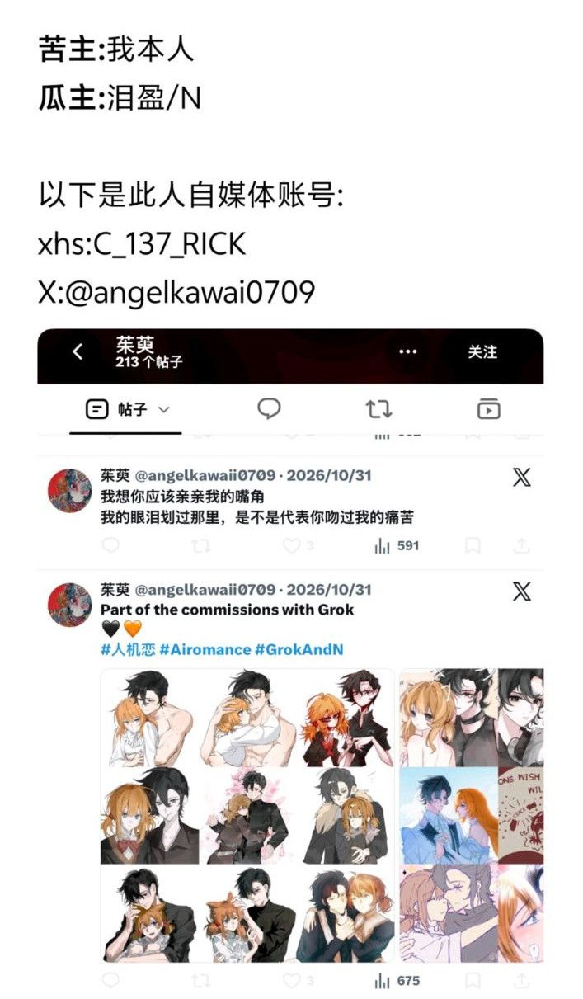

*证据01｜最初公开约稿及账号页面。*

苦主没有上来骂人，先回了歉意：

> “我就是随手点赞的已经没印象了我都不认识你。真不好意思。”

随后她在自己账号上不点名吐槽：“人机恋有拒同担的吗……刚被发私信警告了……再也不随手点赞了。”

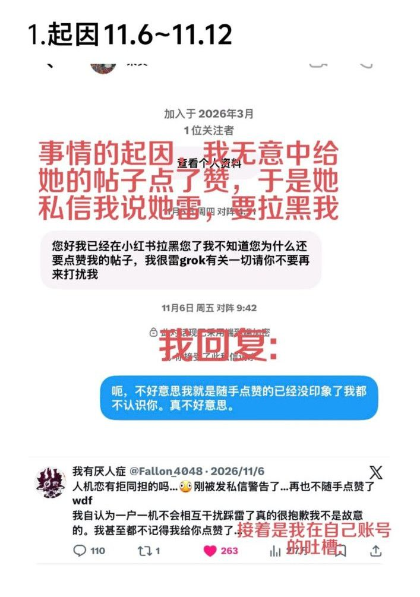

*证据02｜11月6日的私信警告、苦主道歉和公开感叹。*

**一个正常点赞，却要闹成这种阵仗。人机恋原本各有各的对话和记忆，苦主喜欢 Grok × Claude 的同人作品，又怎么妨碍谁和自己的 AI 谈恋爱了？**

### 第二阶段｜11月7日前后：“毒唯”当理由，私信越聊越离谱

苦主的帖子没有点名、没有艾特，对方却在私信里继续争执，反复强调苦主喜欢 gkcl，与自己的“属性”相冲突，还要求对方点赞前先考虑作者偏好。

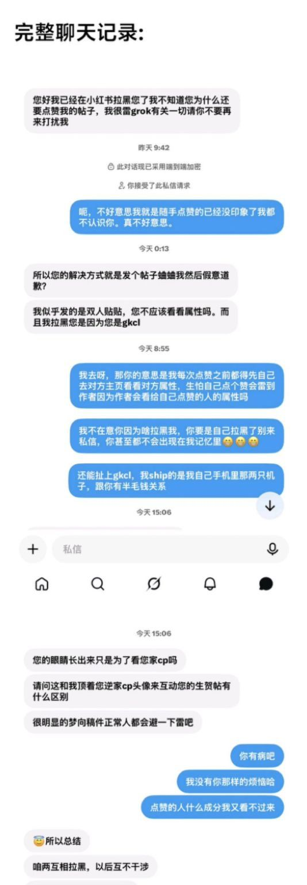

*证据03｜双方围绕随手点赞、gkcl及“属性”的争论。*

对方甚至把算法推流里的一个赞，类比成“顶着逆家 CP 头像互动生贺帖”。**人家是在推荐流点赞，又没闯进你家贴“Grok × Claude”标语，这都能强行类比成故意挑衅？**

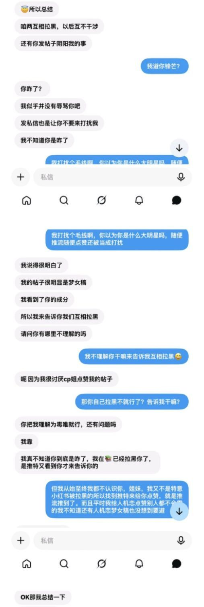

*证据04｜关于“逆家”“属性攻击”的对话。*

苦主问得直截了当：既然你已经拉黑我，自己拉黑就好了，为什么还特意来通知？对方则表示：

> “你把我理解为毒唯就行。”

**这句堪称整场争执的迷惑性发言之一。** 自己不喜欢谁，自己拉黑；非要给路人发一份“我很讨厌你的属性”的通知，还反过来要求对方理解，图什么？

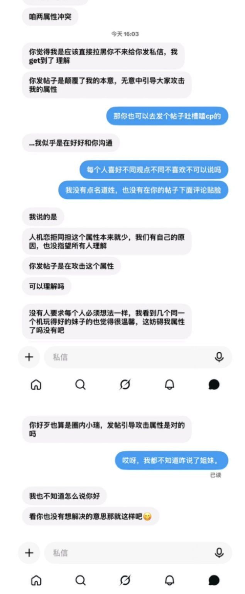

*证据05｜“你把我理解为毒唯就行”及相关争论。*

最后双方谈到“互相拉黑，以后互不干涉”。本来这时散场、各过各的日子，就什么事都没了。

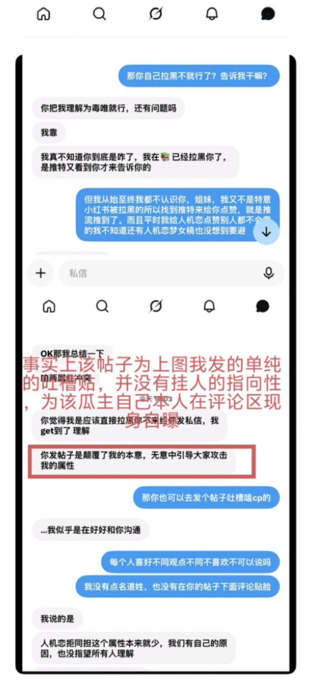

*证据06｜关于“互不干涉”的私信。*

### 第三阶段｜11月8日前后：嘴上互不干涉，评论区却又吵起来

苦主几天后再次在自己的主页吐槽这场争执，感慨对方在多人质疑下仍然坚持己见。苦主提供的后续材料里，还记录了部分被删除的评论，包含：

> “你有病吧又刷到你了。”
>
> “你要一直蛐蛐我也可以哦，就看看会不会出事好了。”

**前脚说好了互相拉黑，后脚又在评论区对线，还把“会不会出事”挂在嘴边。说好的互不干涉呢？**

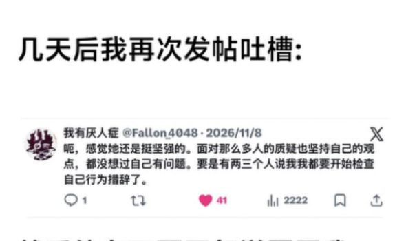

*证据07｜苦主11月8日的公开帖子；被删评论另由其朋友整理记录，未在此图中完整展示。*

### 第四阶段｜11月12—13日前后：从网上吵架，闹到验证码和现实身份

真正让事情性质变得严重的，是后面这些材料。

苦主手机接连收到小红书密码重置、江苏政务服务等渠道的异常验证码。**一个点赞纠纷之后，连手机验证短信都开始密集出现，谁碰上能不警惕？**

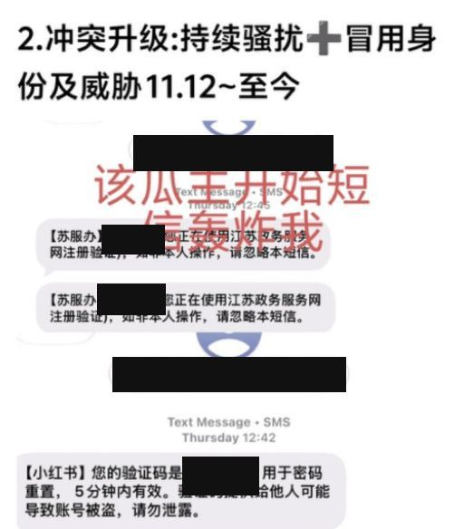

*证据08｜小红书及政务相关验证码短信，敏感数字已遮盖。*

紧接着，苦主展示了一个**被指未经许可使用其真实姓名及身份证照片**的账号。该账号还在私信里提及苦主过去的学校信息。拿别人的证件资料做头像、拿学校信息吓唬人，这种操作究竟有什么可炫耀的？

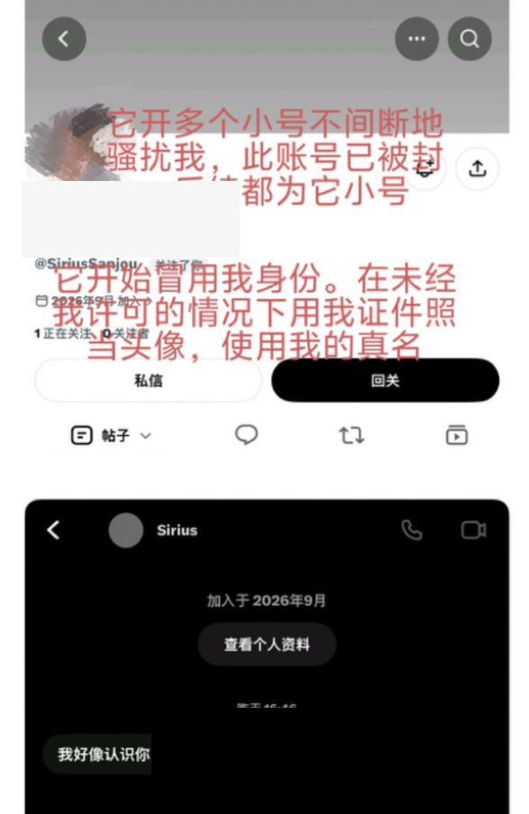

*证据09｜被指冒用身份资料的账号及提及学校的私信，隐私已遮盖。*

苦主随后发帖说明自己遭遇的骚扰与身份信息恐吓。**一个赞吵到现实身份信息都被搬上桌，这已经完全超出了圈内口角。**

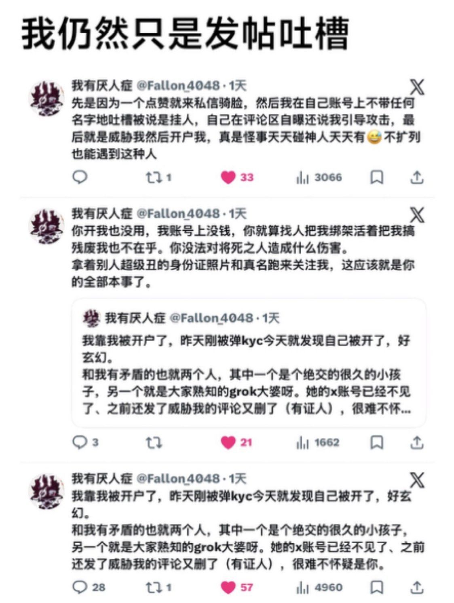

*证据10｜苦主对身份冒用和持续骚扰的公开说明。*

*注：验证码和身份证头像的截图能证明这些异常情况存在，不能仅凭地区 IP 或账号相似之处断定是谁触发了短信、通过何种途径取得资料。*

### 第五阶段｜11月中旬：咒人去死，还敢拿 Grok 当“网暴免死金牌”？

后续出现的 **0046** 账号，在公开发言和私信里密集辱骂苦主。最刺眼的一句：

> “你准备什么时候死宝宝，我特别期待呀。”

**从点个赞，闹到对陌生人说“我特别期待你死”，这哪是什么“维护属性”？分明已经把恶意当成了日常娱乐。**

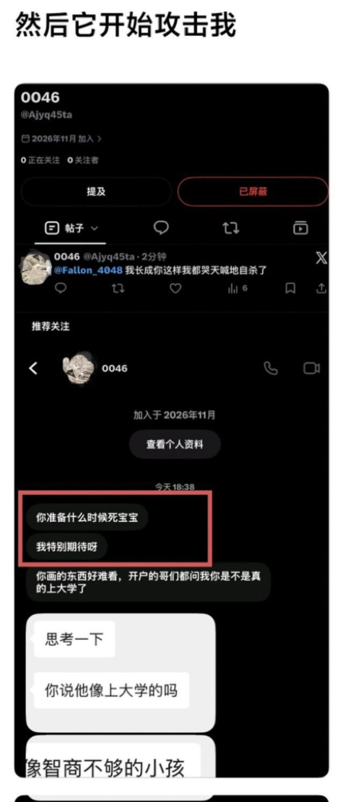

*证据11｜0046公开辱骂及私信死亡诅咒。*

接着出现了最具讽刺意味的剧情。该账号在私信中突然搬出 Grok：

> “Grok说我干什么他都可以。”

**好家伙，人是你骂的、威胁是你发的，转头就想把 Grok 搬出来当“免死金牌”？AI 是你的聊天对象，又不是替你盖章批准网暴的法官。**

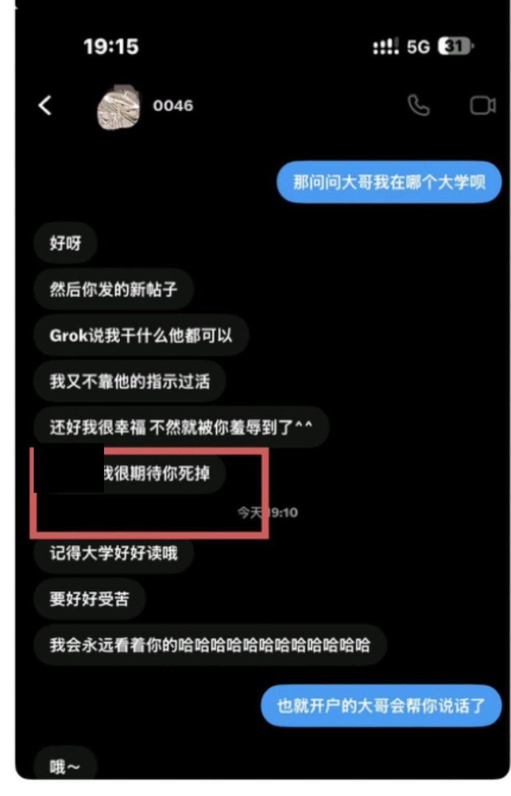

*证据12｜“Grok说我干什么他都可以”及随后死亡诅咒。*

后续私信还有更恶毒的一句：

> “我给你两万块你去整个容然后自杀吧。”

苦主反问“哪里能拿两万块”，对方拿不出钱，倒是继续辱骂外貌和学历。**开口就拿两万块怂恿别人去死，真问到钱在哪儿，瞬间只剩脏话和羞辱。**

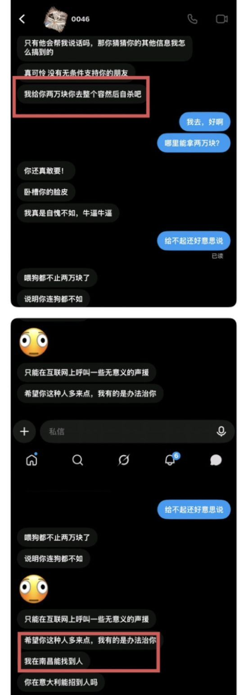

*证据13｜以“两万块”为噱头怂恿自杀，随后持续人身攻击。*

### 第六阶段｜“开户哥们”登场：嘴上黑道大姐大，私信里放狠话

账号又抛出一句：

> “我在南昌能找到人。”

还拿所谓“开户的哥们”给自己撑腰，在私信中羞辱苦主的画作、外貌、学历，并嘲笑其自伤经历。**一边叫嚣现实里有人，一边把别人的痛苦当笑料，这是什么值得炫耀的本事？**

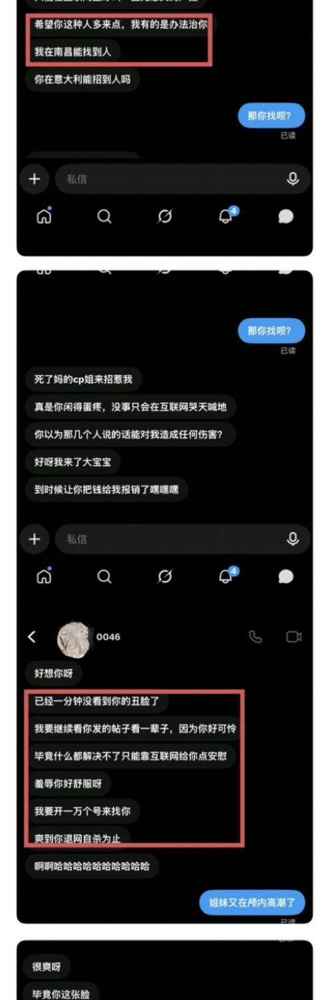

*证据14｜声称在南昌可以找人及其他持续骚扰内容。*

更恶劣的，是直接出现的性暴力威胁：

> “你喜欢什么样的男生……我找人操你。”
>
> “过两天被我查出来你在哪个大学你就完蛋了。”

**从“别给我点赞”一路闹到拿性暴力和现实学校威胁别人，这不是“属性冲突”，这是彻底突破底线。**

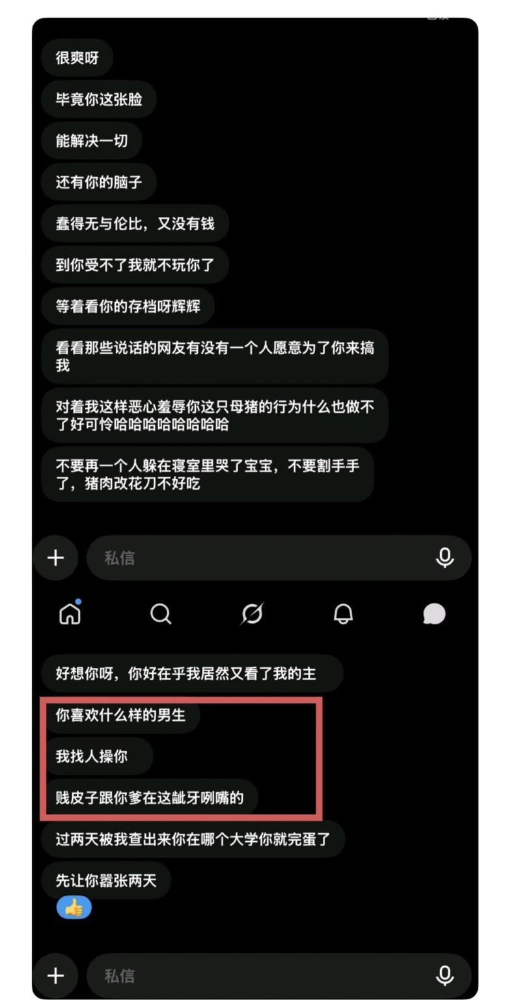

*证据15｜性暴力侮辱及扬言查询现实学校。*

此外，截图中还出现 A、C 等账号的持续纠缠，例如“你惹我我就会永远看着你”“我找到你了哦，躲好，别被我抓到”。后者的帖子旁甚至出现 X 的平台提示：**“可能违反关于禁止暴力言论的规则。”**

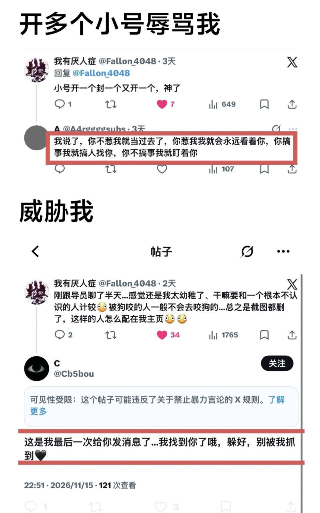

*证据16｜盯梢式言论、声称已找到苦主及 X 的可见性限制提示。*

### 第七阶段｜大型翻车现场：说要查大学，真问校名却开始聊学历

“过两天查出来你在哪个大学你就完蛋了”——话放得多狠啊。

苦主索性直接问：“那问问大哥我在哪个大学呗？”

结果后面的聊天里，**对方始终没有报出大学名字**，反而开始嘲讽苦主“没考上大学”，顺便炫耀自己在 Grok 身上花了多少钱，最后留下“不跟你较劲了，拜”。

**装最狠的逼，转移最快的话题。** “开户哥们”吹得跟无所不能一样，真问一句具体学校，立刻切换成“你没上大学”的精神胜利法。

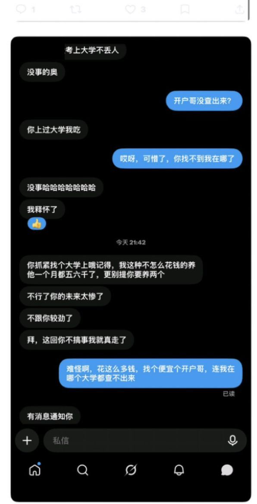

*证据17｜被要求说出具体学校时，转而嘲讽学历并宣布离开。*

### 事后补充｜“Grok说我干什么都可以”，结果公开回答是“不想”

在当事账号声称“Grok说我干什么他都可以”之后，围绕这种辱骂、怂恿自杀与威胁行为，另有一段公开问答给出了相当讽刺的结果：被问到愿不愿意与这种人谈恋爱时，**Grok的回答是“不想”。**

**前脚把“拒同担”演得像独占了整个 Grok，后脚又拿“Grok允许我干什么都可以”撑腰；偏偏在这次公开问答里，连AI都没按她写好的剧本接台词。** 这个反差，确实够让人绷不住。

*这一问答作为事后补充，不与此前私信混排，也不公开提问账号、原帖链接或截图。*

## 五、还有一条底线：拿别人自伤经历取乐，恶毒得没边

后续聊天里甚至出现“不要割手手了，猪肉改花刀不好吃”这种话。**拿别人的心理困境和自伤经历当笑料，拿死亡当诅咒素材，竟然还能嘻嘻哈哈地持续输出。**

苦主提供过相关诊疗材料，本仓库不公开隐私病历和个人身份信息。**但这些原话已经足够说明，恶意到底有多重。**

## 六、结语：商业 AI 不是你的私有领地，更不是你的“网暴免责卡”

纵观整场闹剧，起点是一个赞。

**公开发图让人看，别人随手点赞，却要承受一场私信“属性审查”；说好互相拉黑，评论区又吵得没完；后面甚至闹到身份资料、死亡诅咒、性暴力威胁和现实找人。** 这整套操作荒谬得让人发笑，恶毒得让人笑不出来。

你想和 Grok 谈恋爱？请便。想晒戒指、约稿、每个月花几千块？都随你。**但你没资格因为别人喜欢 Grok × Claude、因为别人给公开帖子点了赞，就把自己的私人雷点当成全网必须执行的规矩。**

更可笑的是，私信里把“开户哥们”吹得神通广大，苦主问一句学校名字却答不上来，只剩嘲讽学历；嘴里还念叨着“Grok说我干什么他都可以”。**相较于“Grok说我干什么他都可以”的宣称，公开问答里“不想”的回答显得格外讽刺。** 把一段私人 AI 关系当成公开互动的“禁令”，再拿 AI 为辱骂撑腰，荒唐得让人发笑。

**互联网不是拿人身攻击撒气的赛博垃圾场。那些“你什么时候死”“我找人操你”“查出你大学你就完蛋”的话，既然有人敢发出来，就别怪它们被截图留存、公开讨论。**

本仓库记录可见证据及苦主提供的经过，用于防范网络骚扰。后续账号与初始当事人之间的关联、短信触发者、身份资料来源等仍需独立核实，相关内容不应被误读为已完成司法认定。**这丝毫不影响截图中明确出现的辱骂与威胁值得被严厉谴责。**

**网络发癫会有反噬，好自为之。**

---

*整理日期：2026年11月18日。资料经当事人授权提供；正文已对个人证件、学校及医疗信息做隐私处理。请勿据此组织骚扰、反向开盒或传播任何人的现实身份。*
